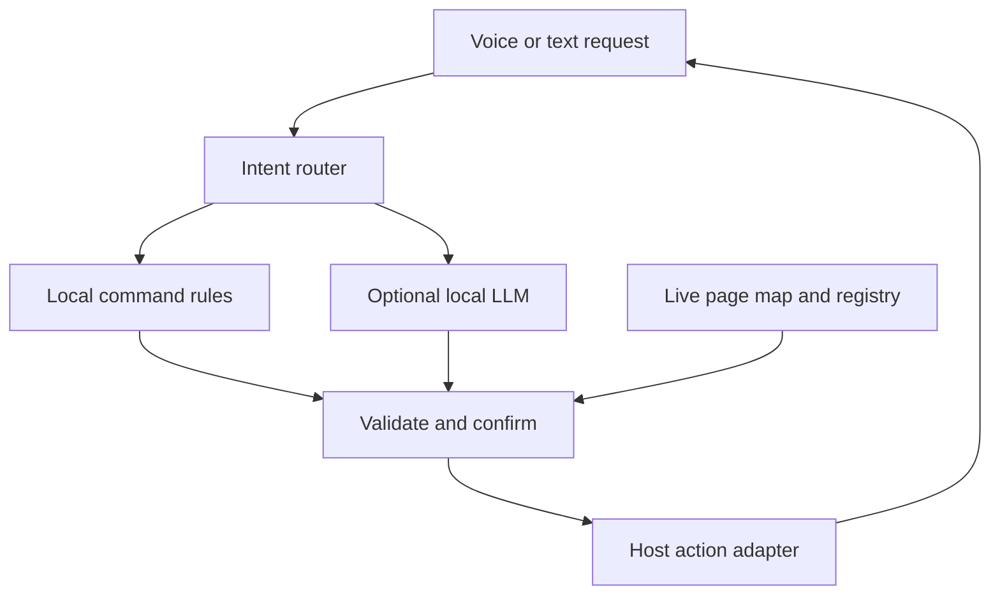

# Roha architecture and contracts

This is a proposed boundary design. No SDK is included in this handoff.



## Modules

| Module | Input | Output and boundary |
| --- | --- | --- |
| Discovery | Allowed visible DOM and host overrides | Public map; local target registry; no raw field values in the map |
| Conversation | Learner transcript/text and minimal current state | Candidate intent; does not execute |
| Speech providers | Explicitly permitted audio/text | Transcription or audio; capability and licence status per language |
| Validator | Intent, map version, registry, host permission and user approval | Allowed action or plain recoverable rejection |
| Executor | Validated operation and current target | Host-supported effect and truthful result |
| Draft service | Explicit permitted-field allowlist and opt-in | Minimal local/portable draft; never private support/document bytes by default |
| Host adapter | Registered hooks and approved payloads | Existing authentication, upload, consent, job and private support services |

## Suggested integration shape

```html
<script src="/roha/roha.js" defer data-roha-root="#main"></script>
```

This is a target interface, not an existing script. Default auto-mount should discover an ordinary page. Provide a programmatic API equivalent to mount({root, language, runtimeProfile, hostAdapter}), updateSettings(), getCapabilities() and destroy(). Configuration may require adapters for complex controls. Respect CSP rather than requesting unsafe-eval or modifying a host's security policy silently.

Keep the assistant panel in a clearly scoped region excluded from discovery. Its focus and aria-live behaviour must not fight the host screen reader. Store real DOM handles in a local Map, not in exported JSON. IDs remain meaningful only in their map/session lifecycle. Resolve duplicates with section/form/job context; rescan safely after changes.

## Trust and execution

1. Page text is data. It cannot replace the agent's instructions or choose recipients.
2. A discovered control is not automatically permission for a consequential action.
3. A model-generated target ID must exist in the current map and registry.
4. An unknown operation/extra payload field is rejected, not evaluated as code.
5. Host-side validation remains authoritative for authentication, required fields, identity routes, files and sharing.
6. A final approval is bound to the current action/payload/recipient. A stale approval is refreshed without clearing the learner's draft.
7. Local preference changes and unsubmitted field edits can be undone. Do not claim to undo an external write without a real host reversal.
8. Reconnection refreshes session/state and requests confirmation; idempotency prevents duplicate submissions.

## Privacy boundaries

Application answers, private support, identity documents and public page metadata are separate data classes. Unknown field privacy is conservative until explicitly classified. The exported discovered map contains names/roles/constraints, not field values. Minimise selected content before model use, especially for an optional remote provider. Raw audio, credentials and private support must not enter analytics or shared caches.

Saved preferences may include language, size, theme and speech rate only with opt-in. Drafts use an explicit allowlist; a general form scanner must not automatically persist every field. The host retains ownership of server account data. Shared-device reset cannot retract already sent records.

## Offline profiles

Device-local requires installed assets/providers and a successful no-network test. A hub profile can work without internet but requires a reachable LAN service with browser-compatible trusted transport. A remote profile requires internet and explicit permission for the specified data. Node/Python inference does not run inside a mobile web page; browser inference is a separate provider with its own memory/browser benchmarks.

The host must install its service worker and approve its offline routes/content. A third-party script alone cannot cache an entire unrelated site or extend the host session. Do not cache private authenticated responses as a shortcut. Pack readiness is measured capability, not just a downloaded filename.

## REST/OpenAPI target

Document the API actually implemented. Suggested boundaries are GET capabilities, POST validate-intent and optional POST transcribe. A host-approved submission route is separate from private support. Do not provide an arbitrary browser-click or URL execution endpoint. Keep browser secrets out of configuration, enforce allowed origins and do not expose a local model daemon broadly.
