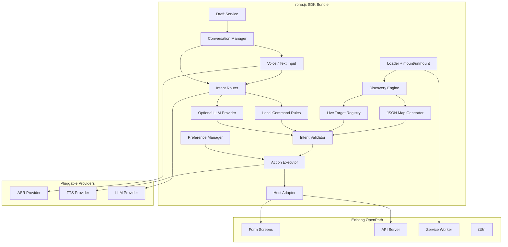

# Roha — Implementation Plan

**Version:** 1.0 | **Created:** 14 November 2026 | **Based on:** SPEC v2.0, existing OpenPath widget at `36ed2dd`

> [!IMPORTANT]
> This plan transforms the existing OpenPath onboarding widget into the full Roha conversational accessibility assistant. The existing app is a working schema-driven sign-up widget (React/Vite/TS) with three forms, voice hooks, offline support, and a test gate of 257 passing assertions. **We build on this foundation, not from scratch.**

---

## 1. Repository Inventory & Starting Position

### What Already Exists (Reuse)

| Component | Location | Roha Coverage |
|---|---|---|
| 3 form schemas (onboard, job, employer) | `schema/*.json` | O01, O02, C01, C03 foundations |
| React form engine (one-question-per-screen) | `app/src/screens.tsx`, `useForm.ts`, `fields.tsx` | O01, O04 partial |
| Voice input hooks | `app/src/speech.tsx` | V01 partial |
| i18n with Amharic/English | `app/src/i18n.ts`, `copy.ts` | L01 partial |
| API server (Node, JSONL) | `api/server.mjs` | I02 partial |
| Service worker + offline | `app/public/sw.js`, `outbox.ts` | F01, F04 partial |
| Accessibility tests (axe, kb, focus) | `app/tests/*.mjs` | A05 partial |
| Docker Compose | `docker-compose.yml` | I03 partial |
| Ethiopic font | `app/public/fonts/` | L05 partial |
| Audio generation scripts | `app/scripts/audio-*.mjs` | L02 partial |

### What Must Be Built (Roha-Specific)

| Module | Feature IDs | Effort |
|---|---|---|
| Semantic DOM discovery engine | D01–D06 | High |
| Generated JSON map + live registry | D03, D04 | High |
| Local intent router (command parsing) | V05, P01 | Medium |
| Optional LLM integration (Qwen3-4B) | V05, A02 | Medium |
| Real text scaling on host content | A01 | Medium |
| Simple explanation engine | A02 | Medium |
| Read-aloud and page navigation | A03 | Medium |
| Natural turn-taking voice loop | V02 | High |
| Answer correction + conversation state | V04 | Medium |
| Alternative ID routes | O05 | Low (schema exists) |
| Private support separation | O06, P03 | Medium |
| Consent + review + submission | O08 | Low (partially exists) |
| Career gateway (job filter, employer form) | C01–C03 | Low (schemas exist) |
| Pack installation + readiness checks | F02, F03 | Medium |
| One-script SDK (`roha.js`) | I01 | High |
| Host adapter / Savanna boundary | I02 | Medium |

---

## 2. Selected Demo Profile

| Attribute | Selection | Rationale |
|---|---|---|
| **Primary language** | English (en) | Full transcription + TTS available |
| **Secondary language** | Amharic (am) | UI + command recognition; existing i18n |
| **Runtime profile** | Device-local first, remote-opt-in fallback | No required paid API |
| **LLM** | Qwen3-4B-Instruct via Ollama (optional) | Free, local, structured output |
| **ASR** | faster-whisper (en, am) + Web Speech API fallback | Offline English; browser fallback |
| **TTS** | Browser SpeechSynthesis API + recorded prompts | Free, offline where installed |
| **Wake** | Foreground only, after explicit enable | No pretrained "Hey Roha" yet |
| **Target device** | Linux/Chrome (dev), Android/Chrome (test) | Covers hackathon demo |
| **Host fixtures** | `host-a.html` (registration), `host-b.html` (job board) | From examples/ |

---

## 3. Architecture — Module Dependency Graph



---

## 4. Module Specifications

### 4.1 Discovery Engine (`src/roha/discovery.ts`)

**Features:** D01, D02, D06

- Walk visible DOM: headings (h1–h6), landmarks (main, nav, aside, header, footer), forms, inputs, selects, textareas, buttons, links, tables, [role] elements
- Resolve accessible names: `<label>`, `aria-labelledby`, `aria-label`, visible text, `title`, `placeholder` (last resort)
- Disambiguate repeated names using parent section/form/fieldset context
- Detect unsupported controls: closed shadow roots, cross-origin iframes, canvas, unlabelled elements
- Exclude Roha's own UI from discovery (via `data-roha-ignore` attribute)
- **Output:** Array of `DiscoveredResource` objects

### 4.2 JSON Map Generator (`src/roha/map.ts`)

**Features:** D03, D04, D05

- Generate schema-valid `site-map.schema.json` output from discovery
- Assign stable session IDs (`mapId`, per-resource `id`)
- Version tracking: `mapVersion` increments on each rescan
- DOM handle registry: `Map<string, Element>` kept locally, never exported
- MutationObserver + debounced rescan (300ms) for dynamic changes
- Route change detection via `popstate` + `hashchange`
- Host override support: `window.__roha_overrides` for custom controls

### 4.3 Intent Router (`src/roha/router.ts`)

**Features:** V05, P01

- **Local command rules** (deterministic, no LLM required):
  - Preferences: `make bigger`, `make smaller`, `reset size`, `high contrast`, `simple mode`
  - Navigation: `back`, `next`, `go to [section]`, `read this`, `explain this`
  - Control: `stop`, `pause`, `continue`, `repeat`, `slower`, `review`
  - Answers: `change [field]`, `cancel`, `undo`
- **LLM fallback** (optional): For flexible/ambiguous wording → structured intent JSON
- Pattern matching with language-specific phrase tables (en, am, ti, om)
- Command vs. dictation disambiguation in voice mode

### 4.4 Intent Validator (`src/roha/validator.ts`)

**Features:** P01, P02

- JSON Schema validation against `intent.schema.json`
- Fresh target registry check: `targetId` must exist in current map
- Map version check: reject stale `mapVersion`
- Allowed arguments check per intent type
- Reject unknown intents, extra fields, forged permissions
- No code execution from model output or page content
- **Output:** `{ valid: boolean, errors: string[] }`

### 4.5 Action Executor (`src/roha/executor.ts`)

**Features:** A01, A02, A03, A04

- `text_scale`: Apply CSS `font-size` scaling to host root, respect existing zoom
- `simple_mode`: Swap question text for reviewed simpler version, keep original accessible
- `read`: Use TTS provider to read selected content / current question
- `explain`: Use LLM or reviewed explanations to simplify content
- `focus` / `navigate`: Programmatic focus to target element via registry
- `contrast`: Toggle `data-roha-contrast` attribute on host root
- `reduced_motion`: Set `prefers-reduced-motion` media override
- `propose_answer`: Set field value through host adapter
- `undo`: Revert last local change from undo stack

### 4.6 Conversation Manager (`src/roha/conversation.ts`)

**Features:** V04, V06, V08, O01–O04

- State machine: `idle → listening → processing → speaking → awaiting_confirmation → idle`
- Track per-field: `{ proposed, accepted, confirmed }` values
- Navigation: current question index, back/next/jump
- No invented information: ask for unknown name, never fabricate details
- No inactivity timer: drafts persist until explicit action
- Low-literacy mode: short sentences, numbered choices, progress indicator
- Resume recap: on return, state current task without private details

### 4.7 Voice Provider (`src/roha/voice.ts`)

**Features:** V01, V02, V03

- Microphone permission flow: accessible button, processing notice, denial fallback
- Turn-taking loop: listen → transcribe → process → speak → listen (no click per field)
- Echo prevention: mute mic during TTS playback
- Persistent Stop button (always visible, keyboard accessible)
- Provider interface:
  ```typescript
  interface ASRProvider {
    start(lang: string): void;
    stop(): void;
    onResult: (text: string, isFinal: boolean) => void;
    onError: (error: ASRError) => void;
  }
  interface TTSProvider {
    speak(text: string, lang: string, rate?: number): Promise<void>;
    stop(): void;
    isSpeaking(): boolean;
  }
  ```
- Implementations: `WebSpeechASR`, `FasterWhisperASR`, `BrowserTTS`, `RecordedPromptTTS`

### 4.8 Draft Service (`src/roha/drafts.ts`)

**Features:** O09, F04

- Explicit opt-in consent for local storage (IndexedDB)
- Field allowlist: exclude private support, identity documents, passwords by default
- Portable export (JSON download) and deletion
- Idempotency keys for submission to prevent duplicates
- Recovery on reconnect without auto-submit

### 4.9 SDK Loader (`src/roha/index.ts` → bundled as `roha.js`)

**Features:** I01

- Public API: `Roha.mount({ root, language, runtimeProfile, hostAdapter })`
- `Roha.updateSettings(settings)`
- `Roha.getCapabilities(): CapabilityEvidence`
- `Roha.destroy()`
- Events: `roha:ready`, `roha:map-updated`, `roha:intent-executed`, `roha:error`
- Scoped styles (Shadow DOM or prefixed CSS)
- CSP-compatible: no `eval`, no inline scripts
- Target: ≤150 KB compressed (core JS + CSS, excluding optional packs)

### 4.10 Host Adapter (`src/roha/host-adapter.ts`)

**Features:** I02, D05

- Interface for host-specific integration:
  ```typescript
  interface HostAdapter {
    submitForm(formId: string, data: FormData): Promise<SubmitResult>;
    getAuthStatus(): AuthStatus;
    onSessionExpiry(handler: () => void): void;
    getCustomControls(): HostOverride[];
    getPrivacyPolicy(): PrivacyConfig;
  }
  ```
- Default adapter: works with standard HTML forms
- Savanna adapter: if starter is provided, integrate; otherwise mark unverified
- OpenPath adapter: bridges to existing `api/server.mjs`

---

## 5. Implementation Stages

### Stage T01: Inspect & Reconcile (Hour 0–1)

**Goal:** Verify existing code, create planning files, begin downloads

| Task | Feature IDs | Output |
|---|---|---|
| Run `cd app && npm install && npm run check` | — | Confirm 257/257 pass |
| Map existing code to Roha features | D01–D06, L03, I02 | Inventory in this document |
| Create STATUS.md from template | All | Per-feature tracking |
| Validate handoff contracts | — | `python tests/validate_contracts.py` pass |
| Start Ollama + Qwen3-4B download | L03 | Background download |
| Start faster-whisper setup | L03 | Background download |
| Create SDK project structure | I01 | `src/roha/` directory |

**Deliverable:** Verified green build, STATUS.md created, downloads started, `src/roha/` scaffolded.

---

### Stage T02: Discover & Act (Hours 1–3)

**Goal:** Automatic page discovery, JSON map, local commands, real UI changes

| Task | Feature IDs | Files Created/Modified |
|---|---|---|
| Build discovery engine | D01, D02 | `src/roha/discovery.ts` |
| Build JSON map generator | D03 | `src/roha/map.ts` |
| Build live target registry | D03, D04 | `src/roha/registry.ts` |
| Add MutationObserver for dynamic DOM | D04 | `src/roha/observer.ts` |
| Add host override support | D05 | `src/roha/overrides.ts` |
| Add unsupported-control detection | D06 | In `discovery.ts` |
| Build intent validator | P01, P02 | `src/roha/validator.ts` |
| Build local command router | V05 | `src/roha/router.ts` |
| Implement text_scale executor | A01 | `src/roha/executors/text-scale.ts` |
| Implement read executor (TTS) | A03 | `src/roha/executors/read.ts` |
| Implement simple_mode executor | A02 | `src/roha/executors/simple-mode.ts` |
| Implement navigate/focus executor | A03 | `src/roha/executors/navigate.ts` |
| Create reusable SDK entry point | I01 | `src/roha/index.ts` |
| Test on both host fixtures | I01 | `examples/host-a.html`, `host-b.html` |

**Acceptance criteria:**
- `host-a.html` loaded → JSON map generated → schema-valid ✓
- `host-b.html` loaded → JSON map generated → schema-valid ✓
- "make bigger" → actual text enlarges on host ✓
- "reset" → text returns to normal ✓
- Stale target ID → rejected ✓

---

### Stage T03: Converse (Hours 3–5)

**Goal:** Working voice conversation, turn-taking, correction, guided form

| Task | Feature IDs | Files Created/Modified |
|---|---|---|
| Build voice provider interface | V01 | `src/roha/voice.ts` |
| Implement Web Speech API ASR | V01, V02 | `src/roha/providers/web-speech-asr.ts` |
| Implement browser TTS | A03 | `src/roha/providers/browser-tts.ts` |
| Build microphone permission flow | V01 | `src/roha/ui/mic-permission.tsx` |
| Build turn-taking loop | V02 | `src/roha/conversation.ts` |
| Add echo prevention | V02 | In `voice.ts` |
| Build conversation state machine | V04 | `src/roha/state.ts` |
| Add answer correction (back/change) | V04 | In `conversation.ts` |
| Add no-fabrication guard | V06 | In `conversation.ts` |
| Integrate with existing form engine | O01, O02 | Bridge `useForm.ts` ↔ `conversation.ts` |
| Add low-literacy mode | O04 | `src/roha/ui/low-literacy.tsx` |
| Add no-inactivity-timer guarantee | O03 | In `conversation.ts` |
| Build language pack structure | L01 | `src/roha/i18n/packs/` |
| Configure faster-whisper provider | L03 | `src/roha/providers/whisper-asr.ts` |
| Test foreground activation | V03 | In `voice.ts` |

**Acceptance criteria:**
- Enable mic → grant → Roha asks first question ✓
- Answer by voice → proposed value shown → accept/reject ✓
- "change my phone" → returns to phone field → corrects ✓
- Deny mic → text input works, no answers lost ✓
- One continuous conversation fills 3+ fields without mic clicks ✓

---

### Stage T04: Finish the Task (Hours 5–7)

**Goal:** Complete registration flow, alternative ID, privacy, consent, offline

| Task | Feature IDs | Files Created/Modified |
|---|---|---|
| Add alternative ID routes | O05 | `src/roha/flows/id-routes.ts` |
| Add private support flow | O06 | `src/roha/flows/private-support.ts` |
| Add learner-controlled file upload | O07 | `src/roha/flows/attachments.ts` |
| Build consent + review screen | O08 | `src/roha/ui/review.tsx` |
| Separate public vs. private payloads | O08, P03 | In `review.tsx`, API layer |
| Build draft save/resume | O09 | `src/roha/drafts.ts` |
| Add draft deletion | O09 | In `drafts.ts` |
| Build minimum-data separation | P03 | `src/roha/privacy.ts` |
| Implement offline cache (service worker) | F01 | Enhance `sw.js` |
| Add runtime profile detection | F02 | `src/roha/runtime-profile.ts` |
| Add pack readiness checks | F03 | `src/roha/readiness.ts` |
| Add loss recovery + idempotency | F04 | In `outbox.ts`, `drafts.ts` |
| Measure core bundle size | F05 | Build script + report |

**Acceptance criteria:**
- "I have no kebele ID" → referral route available ✓
- Private support absent from public payload ✓
- Review screen separates public/private ✓
- No submission before explicit approval ✓
- Disconnect internet → reload → draft recoverable ✓
- Reconnect → no auto-submit ✓

---

### Stage T05: Career & Adoption (Hours 7–9)

**Goal:** Job application, private filter, employer form, second host, Savanna

| Task | Feature IDs | Files Created/Modified |
|---|---|---|
| Wire job application to conversation engine | C01 | `src/roha/flows/job-apply.ts` |
| Build private support-needs filter | C02 | `src/roha/flows/job-filter.ts` |
| Build employer accommodations form | C03 | `src/roha/flows/employer.ts` |
| Verify second-host installation | I01 | Test with `host-b.html` |
| Build Savanna adapter boundary | I02 | `src/roha/adapters/savanna.ts` |
| Create complete README | I03 | `README.md` update |
| Add Docker Compose for Roha | I03 | Update `docker-compose.yml` |
| Generate OpenAPI docs | I02 | Update `openapi.json` |

**Acceptance criteria:**
- Job application reaches review through same SDK ✓
- Filter by "flexible hours" → results change locally, no disclosure ✓
- Employer form captures accommodations ✓
- `roha.js` works on `host-b.html` with no manual schema ✓
- Savanna adapter boundary documented (integration marked per actual status) ✓

---

### Stage T06: Verify & Submit (Hours 9–12)

**Goal:** Accessibility gate, evaluation, demo rehearsal, packaging

| Task | Feature IDs | Files Created/Modified |
|---|---|---|
| Run axe on all states | A05 | Fix critical/serious findings |
| Keyboard-only full task test | A05 | Record results |
| NVDA test (if available) | A05 | Record results |
| TalkBack test (if available) | A05 | Record results |
| 200% zoom test | A05, A01 | Record results |
| Sound-off test | A05 | Record results |
| Security tests (hostile page, injection) | P01, P02 | `tests/security.test.ts` |
| Privacy export audit | P03, O06 | `tests/privacy.test.ts` |
| Co-designer task (if available) | I03 | Record results |
| Create ACCESSIBILITY_REPORT.md | I03 | `ACCESSIBILITY_REPORT.md` |
| Create CAPABILITY_MATRIX.md | I03, L01 | `CAPABILITY_MATRIX.md` |
| Create KNOWN_LIMITATIONS.md | I03 | `KNOWN_LIMITATIONS.md` |
| Rehearse 3-minute demo | I03 | Per DEMO_SCRIPT.md |
| Final STATUS.md update | All | All statuses accurate |

**Acceptance criteria:**
- axe: 0 critical, 0 serious ✓
- Keyboard-only: full task completable ✓
- 200% zoom: usable, no clipped actions ✓
- Sound-off: text equivalents for all audio ✓
- All feature IDs in STATUS.md with truthful status ✓
- Demo runs under 3 minutes ✓

---

## 6. Dependency Installation & Startup

### First-Time Setup

```bash
# 1. Verify existing build
cd /home/welela/Pictures/openpath-accessible-onbording/app
npm install
npx playwright install chromium
npm run check                    # Must exit 0

# 2. Install Ollama + Qwen3 (optional LLM, background)
curl -fsSL https://ollama.ai/install.sh | sh
ollama pull qwen3:4b-instruct &  # ~2.5 GB, runs in background

# 3. Install faster-whisper (optional ASR, background)
pip install faster-whisper &     # Includes model download

# 4. Validate handoff contracts
cd /home/welela/Pictures/openpath-accessible-onbording/Roha_Agent_Handoff
pip install -r requirements-dev.txt
python tests/validate_contracts.py

# 5. Start development
cd /home/welela/Pictures/openpath-accessible-onbording/app
npm run dev                      # http://localhost:5173
```

### Run Commands

| Command | Purpose |
|---|---|
| `npm run dev` | Vite dev server on :5173 |
| `npm run build` | Production build |
| `npm run check` | Full test gate (257+ assertions) |
| `npm run a11y` | Accessibility (axe) tests only |
| `npm run kb` | Keyboard navigation tests |
| `docker compose up -d --build` | Full containerised deployment |
| `ollama serve` | Start local LLM server |
| `python -m faster_whisper.server` | Start local ASR server |

---

## 7. File Structure (New Roha Modules)

```
app/src/roha/
├── index.ts                 # SDK entry: mount/unmount/config/events
├── discovery.ts             # D01, D02, D06: DOM walker + name resolver
├── map.ts                   # D03: JSON map generator
├── registry.ts              # D03: Live DOM handle registry
├── observer.ts              # D04: MutationObserver + route detection
├── overrides.ts             # D05: Host override loader
├── router.ts                # V05: Intent router (rules + LLM fallback)
├── validator.ts             # P01, P02: Schema + registry validation
├── conversation.ts          # V04, V06, V08, O01–O04: Conversation state
├── state.ts                 # State machine definitions
├── voice.ts                 # V01, V02, V03: Voice manager
├── privacy.ts               # P03: Data classification + separation
├── drafts.ts                # O09, F04: Draft save/resume/delete
├── runtime-profile.ts       # F02: Device-local / hub / remote
├── readiness.ts             # F03: Pack readiness checks
├── providers/
│   ├── web-speech-asr.ts    # Browser SpeechRecognition
│   ├── whisper-asr.ts       # faster-whisper via local API
│   ├── browser-tts.ts       # Browser SpeechSynthesis
│   └── recorded-tts.ts      # Pre-recorded prompt audio
├── executors/
│   ├── text-scale.ts        # A01
│   ├── simple-mode.ts       # A02
│   ├── read.ts              # A03
│   ├── navigate.ts          # A03
│   ├── contrast.ts          # A04
│   └── form-action.ts       # O01, propose_answer, choose_file
├── flows/
│   ├── onboard.ts           # O01–O09: Registration flow
│   ├── id-routes.ts         # O05: Alternative ID
│   ├── private-support.ts   # O06: Private support
│   ├── attachments.ts       # O07: File upload
│   ├── job-apply.ts         # C01: Job application
│   ├── job-filter.ts        # C02: Private filter
│   └── employer.ts          # C03: Employer accommodations
├── adapters/
│   ├── default.ts           # Standard HTML forms
│   ├── openpath.ts          # Existing API bridge
│   └── savanna.ts           # Savanna starter (if available)
├── i18n/
│   ├── manager.ts           # L01, L04: Language pack loader
│   └── packs/
│       ├── en.ts            # English UI + commands
│       ├── am.ts            # Amharic UI + commands
│       ├── ti.ts            # Tigrinya UI + commands (partial)
│       └── om.ts            # Oromo UI + commands (partial)
└── ui/
    ├── panel.tsx            # Assistant panel component
    ├── mic-permission.tsx   # V01: Permission flow UI
    ├── review.tsx           # O08: Consent + review
    ├── readiness.tsx        # F03: Offline readiness UI
    └── low-literacy.tsx     # O04: Low-literacy mode
```

---

## 8. Risk Register & Mitigations

| Risk | Impact | Mitigation |
|---|---|---|
| No screen reader tested yet | Gate fail | T06: NVDA + TalkBack testing reserved, 3-hour buffer |
| Qwen3 download too slow | No LLM | Local command rules work without LLM; LLM is optional |
| faster-whisper Amharic quality | Limited ASR | Browser Web Speech API fallback; label ASR as partial |
| Bundle exceeds 150 KB | Perf target miss | Tree-shake aggressively; optional packs separate; report actual size |
| Tigrinya/Oromo ASR unavailable | Language gap | Label as planned/unavailable; UI + commands still possible |
| Savanna starter not provided | Integration unverified | Clean adapter boundary; mark as unverified |
| Co-designer not available | Evidence gap | Record as not-tested; prepare clear task for when available |

---

## 9. Language Capability Matrix (Target)

| Capability | en | am | ti | om |
|---|---|---|---|---|
| UI translations | ✅ Verified | ✅ Existing | 🔲 Planned | 🔲 Planned |
| Command recognition | ✅ Build now | ⚠️ Partial | 🔲 Planned | 🔲 Planned |
| Transcription (ASR) | ✅ faster-whisper | ⚠️ Evaluate | ❌ Not available | ❌ Not available |
| Dynamic TTS | ✅ Browser voices | ⚠️ If installed | ❌ Not tested | ❌ Not tested |
| Recorded prompts | 🔲 Generate | ⚠️ Some exist | 🔲 Planned | 🔲 Planned |
| Wake ("Hey Roha") | 🔲 Test | 🔲 Planned | 🔲 Planned | 🔲 Planned |

> [!NOTE]
> Each cell must be updated to verified/partial/unavailable/not-tested during implementation. This matrix is the target, not a claim of current capability.

---

## 10. Performance Targets

| Metric | Target | How to Measure |
|---|---|---|
| Core JS + CSS (compressed) | ≤ 150 KB | `vite build` → gzip size report |
| Preference update latency | ≤ 200 ms | Performance.now() around intent execution |
| Offline reload | 0 outbound requests | DevTools Network tab, disconnected |
| Time to first question (voice) | ≤ 3 s | From mic permission to first spoken question |
| Discovery scan time | ≤ 500 ms | Performance measurement on host fixtures |

---

## 11. Testing Strategy

### Automated

| Test Type | Tool | Coverage |
|---|---|---|
| Schema contract validation | `validate_contracts.py` | All JSON schemas |
| Accessibility (axe) | `@axe-core/playwright` | All form states, dialogs, review |
| Keyboard navigation | Custom Playwright | Full task flow |
| Intent validation | Unit tests | Valid/invalid/stale/malicious intents |
| Discovery accuracy | Unit tests | Both host fixtures |
| Privacy separation | Unit tests | Payload audit |
| Bundle size | Vite build report | ≤ 150 KB check |

### Manual (T06)

| Test | Device/Tool | Acceptance |
|---|---|---|
| Keyboard-only full task | Desktop Chrome | Complete without mouse |
| NVDA screen reader | Windows/Chrome | Full task audible + navigable |
| TalkBack | Android/Chrome | Full task on mobile |
| 200% zoom | Desktop Chrome | No clipped actions |
| Sound off | Any browser | Text equivalents present |
| Co-designer unaided | With co-designer | Task completion recorded |
| Offline reload | Chrome DevTools offline | Draft recoverable |
| Voice conversation | Real microphone | 3+ fields filled without clicks |

---

## 12. Assumptions & Decisions

1. **Reuse existing React app** as the primary host rather than rewriting in a new framework (per AGENT_PROMPT.txt: "Avoid changing existing code solely to adopt a new framework")
2. **Build Roha SDK as a separate module tree** (`src/roha/`) that integrates with the existing app and can also be bundled standalone
3. **LLM is optional** — all essential commands work through deterministic local rules
4. **English is the verified demo language** — Amharic UI exists but ASR/TTS needs evaluation
5. **Web Speech API as primary ASR** in the browser — faster-whisper as local server alternative
6. **No paid API required** — all providers are free/local
7. **Savanna integration boundary is clean** but marked unverified unless starter is provided
8. **21 October findings** are referenced if provided; their absence is recorded, not fabricated

---

## 13. Next Immediate Action

**Begin Stage T01:**

1. Run `cd app && npm install && npm run check` to verify green build
2. Create `STATUS.md` from `STATUS_TEMPLATE.md`
3. Run `python tests/validate_contracts.py`
4. Create `app/src/roha/` directory structure
5. Start Ollama + model downloads in background
6. Begin `discovery.ts` implementation (Stage T02)

> [!WARNING]
> Do not stop at documents. Begin implementing immediately after T01 setup. The first runnable slice is: discovery engine generates a valid JSON map from `host-a.html` without any supplied schema.

